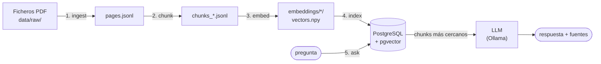

# studies_rag

[English](README.md) · **Español**

Una pipeline de generación aumentada por recuperación (RAG) que responde preguntas sobre tus propios documentos PDF y cita los pasajes que ha usado. Todo funciona en local: el modelo de embeddings, la base de datos vectorial y el LLM, en una sola GPU doméstica (desarrollado con una RTX 3070 de 8 GB).

Está construida paso a paso como proyecto de aprendizaje. Cada pieza está escrita a mano detrás de una interfaz pequeña, para poder leerla, medirla y sustituirla. Un divisor de texto de LangChain se incluye solo para compararlo con el chunker propio.

## Cómo funciona

La pipeline es una cadena de pasos. Cada paso es un script que lee la salida del anterior y escribe la suya, así que cualquier paso se puede volver a ejecutar, inspeccionar o sustituir por separado.



| Paso | Script | Lee | Escribe | Detalles |
|---|---|---|---|---|
| 1. Ingesta | `ingest` | PDFs en `data/raw/<colección>/` | `pages.jsonl`: una página limpia por línea (texto + metadatos) | [docs](docs/01-ingestion.es.md) |
| 2. Chunking | `chunk` | `pages.jsonl` | `chunks_<chunker>.jsonl`: un chunk por línea | [docs](docs/02-chunking.es.md) |
| 3. Embeddings | `embed` | chunks | `embeddings/<chunker>/`: vectores, ids de los chunks y un manifest | [docs](docs/03-embeddings.es.md) |
| 4. Base de datos vectorial | `index` | chunks + embeddings | una tabla por chunker en PostgreSQL | [docs](docs/04-vector-store.es.md) |
| 5. Recuperación + generación | `ask` | la base de datos vectorial | respuestas en la terminal | [docs](docs/05-retrieval-generation.es.md) |

Los pasos 2 a 4 ejecutan todos los chunkers configurados, así que las dos estrategias de chunking se pueden comparar de principio a fin. Los pasos 3 y 4 se saltan el trabajo cuando sus entradas y su configuración no han cambiado.

Al hacer una pregunta:

1. La pregunta se convierte en vector con el mismo modelo que los chunks, más una instrucción de consulta.
2. PostgreSQL devuelve los `k` chunks cuyos vectores están más cerca (similitud coseno).
3. Los chunks entran en un prompt como pasajes numerados, cada uno etiquetado con su procedencia.
4. El LLM responde usando solo esos pasajes y los cita como `[1]`, `[2]`…
5. El script muestra la respuesta y la lista de fuentes, marcando las citadas.

## Arquitectura

Cada componente que depende de una tecnología externa, o que tiene estrategias intercambiables, está detrás de una clase abstracta pequeña (un *puerto*). Cada implementación (un *adaptador*) se registra con un nombre, y `config.json` elige cuál usar.

| Puerto | Función | Implementaciones |
|---|---|---|
| `Adapter` | convertir un fichero de origen en páginas limpias con metadatos | `master_notes`: PDFs generados con una plantilla web fija |
| `Chunker` | dividir las páginas en chunks | `structured` (propio), `langchain` |
| `Embedder` | convertir texto en vectores normalizados | `sentence_transformers` (Hugging Face) |
| `VectorStore` | guardar conjuntos de embeddings y buscar en ellos | `pgvector` (PostgreSQL) |
| `LLM` | generar una respuesta a partir de instrucciones + prompt | `ollama` |

El núcleo (`rag.py` y los scripts de cada paso) solo usa los puertos. Para admitir otro formato de documento, otra base de datos vectorial u otro LLM basta con escribir una clase y añadir una línea a un registro.

La configuración está en `config.json`, con una sección por paso. Los secretos (credenciales de la base de datos) vienen de variables de entorno, que en local se pueden definir en un fichero `.env`.

## Requisitos

- Python 3.12
- Docker con Compose, y acceso a la GPU desde los contenedores (NVIDIA Container Toolkit). Se comprueba con `docker run --rm --gpus all ubuntu nvidia-smi`.
- Una GPU NVIDIA de unos 8 GB. El modelo de embeddings ocupa unos 1,2 GB y el LLM por defecto unos 3,7 GB.

## Puesta en marcha

```bash
# 1. Entorno de Python
python3.12 -m venv .venv
.venv/bin/pip install -r requirements.txt

# 2. Configuración y secretos
cp config.example.json config.json
cp .env.example .env              # y pon una POSTGRES_PASSWORD de verdad

# 3. Servicios: PostgreSQL + pgvector, y Ollama con el LLM
docker compose up -d
docker compose exec ollama ollama pull qwen3.5:4b

# 4. Tus documentos: una carpeta por colección
mkdir -p data/raw/mi_coleccion     # y copia ahí tus PDFs

# 5. Ejecutar la pipeline
export PYTHONPATH=src
.venv/bin/python -m studies_rag.ingest
.venv/bin/python -m studies_rag.chunk
.venv/bin/python -m studies_rag.embed    # la primera vez descarga el modelo de embeddings
.venv/bin/python -m studies_rag.index
.venv/bin/python -m studies_rag.ask      # escribe una pregunta; una línea vacía termina
```

> **Sobre los documentos.** El adaptador incluido, `master_notes`, lee PDFs generados con una plantilla concreta: una portada, un índice interno y cabeceras y pies de página en posiciones fijas. Para cualquier otro tipo de documento necesitarás tu propio adaptador, una clase con un método que devuelve páginas. Consulta [Ingesta](docs/01-ingestion.es.md#escribir-un-adaptador). Este repositorio no incluye documentos.

## Configuración

| Sección | La usa | Ajustes principales |
|---|---|---|
| `ingest` | paso 1 | adaptador y sus opciones, carpeta de entrada, fichero de salida |
| `chunk` | paso 2 | chunkers que se ejecutan y sus tamaños |
| `embed` | pasos 3–5 | modelo y revisión fijada, instrucción de consulta, plantilla de la cabecera de contexto |
| `index` | pasos 4–5 | base de datos vectorial y sus opciones de conexión |
| `query` | paso 5 | conjunto de chunks en el que buscar, `k`, el LLM y sus opciones, prompt de sistema |

La variable de entorno `RAG_CONFIG` permite usar otro fichero de configuración. El `.env` define `POSTGRES_USER`, `POSTGRES_PASSWORD` y `POSTGRES_DB`, que usan tanto Docker Compose como el código de Python.

## Estructura del repositorio

```
├── config.example.json         plantilla de configuración (cópiala a config.json)
├── .env.example                plantilla de secretos (cópiala a .env)
├── docker-compose.yml          servicios: db (PostgreSQL + pgvector), ollama
├── db/init/                    SQL que se ejecuta al crear la base de datos (extensión pgvector)
├── requirements.txt
├── docs/                       un documento por paso
└── src/studies_rag/
    ├── config.py               fichero de configuración + variables de entorno
    ├── ingest.py               paso 1   ─┐
    ├── chunk.py                paso 2    │ pasos de la pipeline: cada uno tiene un main()
    ├── embed.py                paso 3    │ que lee su sección de la configuración
    ├── index.py                paso 4    │
    ├── ask.py                  paso 5   ─┘ (punto de entrada en la terminal)
    ├── rag.py                  el núcleo que responde preguntas
    ├── adapters/               puerto + implementaciones, un paquete por puerto
    ├── chunkers/
    ├── embedders/
    ├── vector_stores/
    └── llms/
```

## Hoja de ruta

- [x] 1. Ingesta
- [x] 2. Chunking (dos estrategias)
- [x] 3. Embeddings
- [x] 4. Base de datos vectorial
- [x] 5. Recuperación + generación
- [ ] 6. Evaluación: recall@k de la recuperación, fidelidad de las respuestas, comparación de los chunkers y de la cabecera de contexto
- [ ] 7. Mejoras: búsqueda híbrida (texto completo + vectores), reranking, *contextual retrieval*
- [ ] La propia aplicación en Docker, con una API HTTP

## Licencia

Todavía no se ha elegido una licencia, así que por ahora todos los derechos están reservados. Ten en cuenta que el paso de ingesta usa [PyMuPDF](https://pymupdf.readthedocs.io/), con licencia AGPL-3.0.
