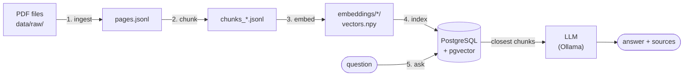

# studies_rag

**English** · [Español](README.es.md)

A retrieval-augmented generation (RAG) pipeline that answers questions about your own PDF documents, citing the passages it used. Everything runs locally: the embedding model, the vector database and the LLM, on a single consumer GPU (developed on an 8 GB RTX 3070).

It is built step by step as a learning project. Each piece is written by hand behind a small interface, so it can be read, measured and swapped. A LangChain text splitter is included only to compare it with the hand-written chunker.

## How it works

The pipeline is a chain of steps. Each step is a script that reads the output of the previous one and writes its own, so any step can be rerun, inspected or replaced on its own.



| Step | Script | Reads | Writes | Details |
|---|---|---|---|---|
| 1. Ingestion | `ingest` | PDFs in `data/raw/<collection>/` | `pages.jsonl`: one clean page per line (text + metadata) | [docs](docs/01-ingestion.md) |
| 2. Chunking | `chunk` | `pages.jsonl` | `chunks_<chunker>.jsonl`: one chunk per line | [docs](docs/02-chunking.md) |
| 3. Embeddings | `embed` | chunks | `embeddings/<chunker>/`: vectors, chunk ids and a manifest | [docs](docs/03-embeddings.md) |
| 4. Vector store | `index` | chunks + embeddings | one table per chunker in PostgreSQL | [docs](docs/04-vector-store.md) |
| 5. Retrieval + generation | `ask` | the vector store | answers in the terminal | [docs](docs/05-retrieval-generation.md) |

Steps 2 to 4 run every configured chunker, so the two chunking strategies can be compared end to end. Steps 3 and 4 skip their work when their inputs and settings haven't changed.

At question time:

1. The question is embedded with the same model that embedded the chunks, plus a query instruction.
2. PostgreSQL returns the `k` chunks whose vectors are closest to it (cosine similarity).
3. The chunks go into a prompt as numbered passages, each one labelled with where it comes from.
4. The LLM answers using only those passages and cites them as `[1]`, `[2]`…
5. The script prints the answer and the list of sources, marking the cited ones.

## Architecture

Every component that depends on an external technology or that has interchangeable strategies sits behind a small abstract class (a *port*). Each implementation (an *adapter*) is registered under a name, and `config.json` chooses which one to use.

| Port | Role | Implementations |
|---|---|---|
| `Adapter` | turn a source file into clean pages with metadata | `master_notes`: PDFs made from a fixed web template |
| `Chunker` | split pages into chunks | `structured` (hand-written), `langchain` |
| `Embedder` | turn text into normalized vectors | `sentence_transformers` (Hugging Face) |
| `VectorStore` | store embedding sets and search them | `pgvector` (PostgreSQL) |
| `LLM` | generate an answer from instructions + prompt | `ollama` |

The core (`rag.py`, the step scripts) only uses the ports. Supporting another document format, vector database or LLM means writing one class and adding one line to a registry.

Settings live in `config.json`, one section per step. Secrets (database credentials) come from environment variables, which can be set in a `.env` file for local runs.

## Requirements

- Python 3.12
- Docker with Compose, and GPU access for containers (NVIDIA Container Toolkit). Check it with `docker run --rm --gpus all ubuntu nvidia-smi`.
- An NVIDIA GPU with about 8 GB. The embedding model takes about 1.2 GB and the default LLM about 3.7 GB.

## Quick start

```bash
# 1. Python environment
python3.12 -m venv .venv
.venv/bin/pip install -r requirements.txt

# 2. Settings and secrets
cp config.example.json config.json
cp .env.example .env              # then set a real POSTGRES_PASSWORD

# 3. Services: PostgreSQL + pgvector, and Ollama with the LLM
docker compose up -d
docker compose exec ollama ollama pull qwen3.5:4b

# 4. Your documents: one folder per collection
mkdir -p data/raw/my_collection   # and copy your PDFs into it

# 5. Run the pipeline
export PYTHONPATH=src
.venv/bin/python -m studies_rag.ingest
.venv/bin/python -m studies_rag.chunk
.venv/bin/python -m studies_rag.embed    # downloads the embedding model the first time
.venv/bin/python -m studies_rag.index
.venv/bin/python -m studies_rag.ask      # type a question; an empty line quits
```

> **About the documents.** The bundled adapter, `master_notes`, reads PDFs produced from one particular template: a cover page, an internal table of contents, and page headers and footers at fixed positions. For any other kind of document you'll need your own adapter, a class with one method that yields pages. See [Ingestion](docs/01-ingestion.md#writing-an-adapter). No documents are included in this repository.

## Configuration

| Section | Used by | Main settings |
|---|---|---|
| `ingest` | step 1 | adapter and its options, input folder, output file |
| `chunk` | step 2 | chunkers to run and their sizes |
| `embed` | steps 3–5 | model and pinned revision, query instruction, context header template |
| `index` | steps 4–5 | vector store and its connection options |
| `query` | step 5 | which chunk set to search, `k`, LLM and its options, system prompt |

The `RAG_CONFIG` environment variable points to another config file. `.env` provides `POSTGRES_USER`, `POSTGRES_PASSWORD` and `POSTGRES_DB`, used both by Docker Compose and by the Python code.

## Repository layout

```
├── config.example.json         settings template (copy to config.json)
├── .env.example                secrets template (copy to .env)
├── docker-compose.yml          services: db (PostgreSQL + pgvector), ollama
├── db/init/                    SQL run when the database is first created (pgvector extension)
├── requirements.txt
├── docs/                       one document per step
└── src/studies_rag/
    ├── config.py               config file + environment variables
    ├── ingest.py               step 1   ─┐
    ├── chunk.py                step 2    │ pipeline steps: each one has a main()
    ├── embed.py                step 3    │ that reads its config section
    ├── index.py                step 4    │
    ├── ask.py                  step 5   ─┘ (terminal entry point)
    ├── rag.py                  the question-answering core
    ├── adapters/               port + implementations, one package per port
    ├── chunkers/
    ├── embedders/
    ├── vector_stores/
    └── llms/
```

## Roadmap

- [x] 1. Ingestion
- [x] 2. Chunking (two strategies)
- [x] 3. Embeddings
- [x] 4. Vector store
- [x] 5. Retrieval + generation
- [ ] 6. Evaluation: retrieval recall@k, answer faithfulness, comparison of the chunkers and of the context header
- [ ] 7. Improvements: hybrid search (full-text + vectors), reranking, contextual retrieval
- [ ] The application itself in Docker, with an HTTP API

## License

No license has been chosen yet, so all rights are reserved for now. Note that the ingestion step uses [PyMuPDF](https://pymupdf.readthedocs.io/), which is licensed under AGPL-3.0.
